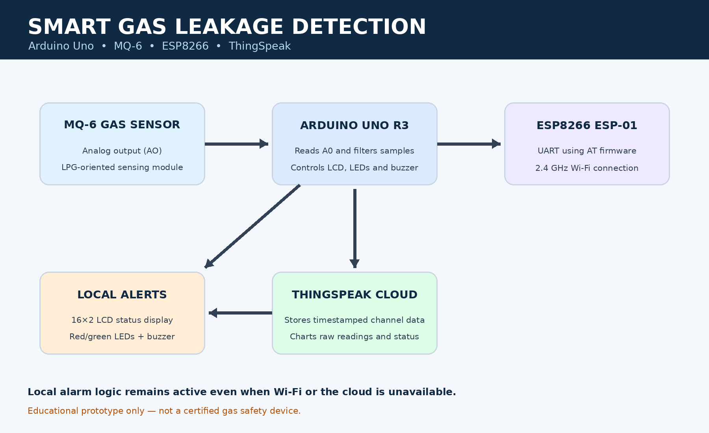
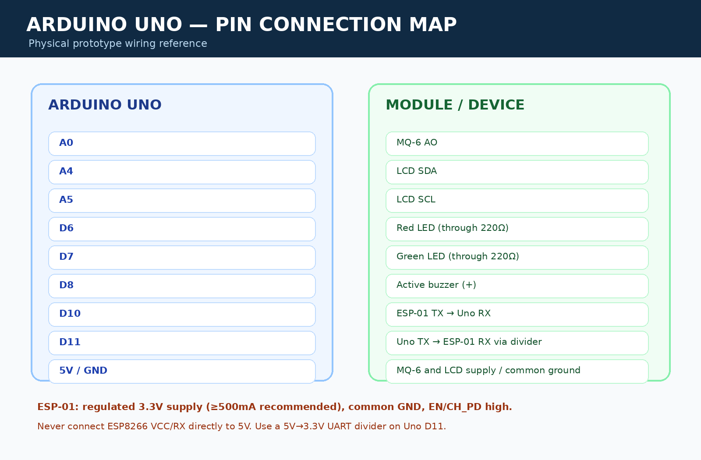

# Smart Gas Leakage Detection and Alert System with Cloud Data Monitoring

An Arduino-based smart gas leakage detection and monitoring system that detects LPG leakage using an MQ-6 gas sensor and provides immediate visual and audible alerts through LEDs, a buzzer, and an LCD display. The system also uses an ESP8266 Wi-Fi module to upload sensor readings and leakage status to the ThingSpeak cloud platform for remote monitoring and data visualization.

## Project Overview

The project is designed to detect potentially dangerous gas leakage conditions in residential and other indoor environments. The MQ-6 gas sensor continuously monitors changes in gas concentration and sends analog readings to the Arduino Uno R3.

When the detected sensor reading exceeds a predefined threshold, the Arduino activates a warning system consisting of a red LED and buzzer. Under normal conditions, the green LED remains ON to indicate a safe status.

A 16×2 LCD displays the current sensor reading and system status. Additionally, an ESP8266 Wi-Fi module communicates with the ThingSpeak cloud server, where sensor readings and leakage status are stored for remote monitoring and historical analysis.



## Project Components

The complete project consists of an Arduino Uno R3, MQ-6 gas sensor, ESP8266 ESP-01 Wi-Fi module, active buzzer, red and green LEDs, 220 Ω resistors, 16×2 I2C LCD, and a regulated 3.3V power supply for the ESP8266.



## Project Demonstration

### 1. Normal / Safe Condition

When the gas sensor reading remains below the predefined alert threshold, the system operates in its normal monitoring state.

The green LED indicates that the sensor reading is below the configured threshold, while the red LED and buzzer remain OFF. The LCD displays the current sensor reading and safe status.

The system operates in the following state:

```text
Green LED  → ON
Red LED    → OFF
Buzzer     → OFF

LCD:
GAS: NORMAL
STATUS: SAFE
```

The Arduino continuously monitors the sensor and periodically uploads the readings to the ThingSpeak cloud server whenever Wi-Fi connectivity is available.

### 2. Gas Leakage / Alert Detected

When the gas sensor reading exceeds the predefined threshold, the Arduino identifies a possible gas leakage condition and activates the warning system.

The red LED and buzzer turn ON, while the green LED turns OFF. The LCD displays a warning message indicating the detected condition.

The system changes to:

```text
Green LED  → OFF
Red LED    → ON
Buzzer     → ON

LCD:
GAS WARNING!
STATUS: ALERT
```

The sensor reading and alert status are also uploaded to ThingSpeak for remote monitoring.

### 3. Cloud Data Monitoring

The ESP8266 Wi-Fi module establishes an internet connection and transmits sensor readings to the ThingSpeak cloud platform.

The cloud server stores the uploaded information and provides graphical representations of the sensor data.

The cloud monitoring system provides:

- Gas sensor analog readings.
- Normalized sensor-level values.
- Current leakage status.
- Historical sensor data.
- Time-based graphs for monitoring changes.

The cloud connection is independent of the local alarm logic. Therefore, local alerts continue operating even if the Wi-Fi connection or cloud server is unavailable.

## Features

- MQ-6-based LPG gas leakage detection.
- Continuous gas sensor monitoring.
- Automatic audible warning using an active buzzer.
- Red LED warning indicator.
- Green LED safe-status indicator.
- 16×2 LCD for displaying sensor readings and system status.
- ESP8266-based Wi-Fi connectivity.
- ThingSpeak cloud integration.
- Remote monitoring of sensor readings.
- Historical data storage and graphical visualization.
- Automatic threshold-based alert detection.
- Local alarm operation during internet connectivity failure.
- Arduino-based embedded control system.
- Wokwi simulation for testing the local detection and alert logic.

## Components

- Arduino Uno R3
- MQ-6 Gas Sensor Module
- ESP8266 ESP-01 Wi-Fi Module
- Active Buzzer
- Red LED
- Green LED
- 2 × 220-ohm resistors
- 1 × 1kΩ resistor
- 1 × 2kΩ resistor
- 16×2 LCD with I2C interface
- Regulated 3.3V power supply for ESP8266
- Decoupling capacitor for ESP8266 power supply
- Breadboard
- Jumper wires

## Circuit Connections

| **Component** | **Arduino Connection** |
|---|---|
| MQ-6 VCC | 5V |
| MQ-6 GND | GND |
| MQ-6 Analog Output | A0 |
| Red LED | D6 through 220 Ω resistor |
| Green LED | D7 through 220 Ω resistor |
| Buzzer positive | D8 |
| Buzzer negative | GND |
| LCD SDA | A4 |
| LCD SCL | A5 |
| LCD VCC | 5V |
| LCD GND | GND |
| ESP8266 TX | D10 |
| ESP8266 RX | D11 through voltage divider |

The ESP8266 ESP-01 requires a regulated 3.3V power supply. Its VCC, EN/CH_PD, GPIO0 and GPIO2 pins must be configured according to its normal operating requirements.

The Arduino D11 transmit signal is connected to the ESP8266 RX through a voltage divider consisting of 1kΩ and 2kΩ resistors to reduce the 5V logic signal to approximately 3.3V.

All circuit components must share a common ground.

**Important:** Never connect the ESP8266 power or input pins directly to 5V. Use an appropriate external regulator capable of supplying the module's peak current requirements.

## How It Works

### 1. Gas Detection

The MQ-6 gas sensor detects changes in the concentration of LPG and other combustible gases.

The sensor module provides an analog output connected to Arduino analog pin A0.

The Arduino continuously reads the analog sensor value and processes the readings to determine the current monitoring condition.

The sensor readings are represented by a 10-bit ADC value:

```text
ADC Range = 0 to 1023
```

The system uses a configurable threshold to identify a possible leakage condition.

### 2. Normal / Safe Condition

When the filtered sensor reading remains below the configured threshold, the system operates in the normal monitoring condition.

The system indicates:

```text
Green LED  → ON
Red LED    → OFF
Buzzer     → OFF
LCD        → STATUS: SAFE
```

The current sensor reading is displayed on the LCD.

### 3. Gas Leakage Detection

When the filtered sensor reading reaches or exceeds the configured alert threshold, the Arduino activates the warning system.

The system changes to:

```text
Green LED  → OFF
Red LED    → ON
Buzzer     → ON
LCD        → STATUS: ALERT
```

The LCD displays a warning message indicating a possible gas leakage condition.

The Arduino also sends the sensor reading and alert status to the ESP8266 for cloud transmission.

### 4. Cloud Data Transmission

The ESP8266 establishes a Wi-Fi connection and communicates with the ThingSpeak cloud server.

The Arduino sends sensor information through serial communication using the ESP8266 AT command interface.

The following information is uploaded:

```text
Field 1 → Raw Gas Sensor ADC Value
Field 2 → Normalized Sensor Level
Field 3 → Leakage Status

Status:
0 → SAFE
1 → ALERT
```

ThingSpeak stores the uploaded information and generates graphs to visualize the changes in sensor readings over time.

The cloud update interval is configured to approximately 20 seconds.

### 5. Cloud Monitoring

The user can access the ThingSpeak channel through an internet-connected device to monitor the uploaded sensor information.

The dashboard provides historical readings and graphical representations, helping users observe changes in gas sensor values and identify recorded warning conditions.

### 6. Internet Connectivity Failure

If the ESP8266 loses its Wi-Fi connection or the cloud server becomes unavailable, the Arduino continues its local sensor monitoring and alert operations.

The buzzer, LEDs and LCD continue working independently of cloud connectivity.

This ensures that the basic local warning functionality does not depend on internet availability.

## System Logic

| **Gas Condition** | **Green LED** | **Red LED** | **Buzzer** | **LCD Status** |
|---|---|---|---|---|
| Normal sensor reading | ON | OFF | OFF | SAFE |
| Threshold exceeded | OFF | ON | ON | ALERT |
| Wi-Fi disconnected | Depends on sensor | Depends on sensor | Depends on sensor | Local status maintained |
| Cloud unavailable | Depends on sensor | Depends on sensor | Depends on sensor | Local status maintained |

## System Flow

```text
              START
                |
                v
        Initialize Arduino
                |
                v
        Initialize MQ-6 Sensor
                |
                v
        Initialize LCD & LEDs
                |
                v
        Initialize ESP8266
                |
                v
         Read Gas Sensor
                |
                v
        Filter Sensor Reading
                |
                v
       Compare With Threshold
                |
          +-----+-----+
          |           |
     Normal Level   High Level
          |           |
          v           v
      GREEN LED    RED LED ON
         ON         BUZZER ON
      RED LED OFF
      BUZZER OFF
          |           |
          v           v
      LCD: SAFE    LCD: ALERT
          |           |
          +-----+-----+
                |
                v
       Check Wi-Fi Connection
                |
                v
        Upload Data to Cloud
                |
                v
       Update ThingSpeak Channel
                |
                v
        Continue Monitoring
                |
                +-------> Repeat
```

## Running the Project in Wokwi

The project uses Wokwi for simulating the Arduino-based gas detection and local alert logic.

The Wokwi simulation uses its MQ-2 gas sensor model as a substitute for testing the sensor-processing logic. The final physical hardware uses the MQ-6 gas sensor.

1. Open **Wokwi Circuits**.
2. Create a new Arduino Uno project.
3. Add the Arduino Uno R3.
4. Add the supported gas sensor model.
5. Add the 16×2 I2C LCD.
6. Add the red and green LEDs.
7. Add the buzzer.
8. Connect the components according to the simulation circuit diagram.
9. Open the Arduino code editor.
10. Copy the simulation program from `Wokwi_Simulation/gas_leakage_simulation.ino`.
11. Start the simulation.
12. Adjust the gas sensor value to test the normal and alert conditions.
13. Observe the LCD, LEDs, buzzer and Serial Monitor output.

**Note:** The Wokwi simulation validates the local detection and alert logic. It does not simulate the complete ESP8266 ESP-01 and ThingSpeak hardware communication. Cloud integration is intended for the physical Arduino and ESP8266 setup.

## Simulation Demonstration

### Before Gas Leakage Detection

When the simulated gas sensor reading is below the configured threshold, the system remains in its normal monitoring condition.

```text
GREEN LED → ON
RED LED   → OFF
BUZZER    → OFF

LCD:
STATUS: SAFE
```

### After Gas Leakage Detection

When the simulated sensor reading exceeds the configured threshold, the Arduino activates the warning indicators.

```text
GREEN LED → OFF
RED LED   → ON
BUZZER    → ON

LCD:
STATUS: ALERT
```

The same detection logic is intended to be used with the physical MQ-6 sensor.

## Applications

This project can be used as an educational prototype for:

- Smart home gas monitoring systems
- Kitchen LPG leakage monitoring
- LPG cylinder monitoring demonstrations
- Industrial gas monitoring prototypes
- Laboratory gas monitoring demonstrations
- Smart building safety monitoring
- IoT-based environmental monitoring
- Remote sensor data monitoring

## Advantages

- Low-cost embedded IoT prototype.
- Continuous sensor monitoring.
- Immediate local visual and audible alerts.
- Wireless cloud data transmission.
- Remote access to sensor readings.
- Historical data storage and visualization.
- Local alert functionality does not depend on internet connectivity.
- Easy to expand with additional sensors and communication modules.
- Wokwi simulation enables testing of the local detection logic before physical implementation.

## Limitations

- MQ-6 readings require proper warm-up and calibration.
- Raw ADC readings cannot be directly interpreted as gas concentration in PPM.
- Sensor performance can be affected by temperature, humidity, ageing and other gases.
- The ESP8266 requires a stable external 3.3V power supply.
- Cloud monitoring depends on Wi-Fi and internet availability.
- The project does not automatically shut off the gas supply.
- The prototype is not a certified commercial gas safety system and must not replace a certified LPG detector.

## Future Improvements

The system can be further improved by adding:

- Mobile notifications through Telegram or SMS.
- A dedicated web-based IoT monitoring dashboard.
- Temperature and humidity sensors.
- Multiple gas sensors for monitoring larger areas.
- Automatic gas supply shutoff using a professionally designed fail-safe valve system.
- Battery backup for operation during power failures.
- Sensor fault detection and calibration monitoring.
- Real-time event logging and cloud analytics.
- Secure device authentication and encrypted cloud communication.
- Multiple-device monitoring through a centralized dashboard.

## Technologies Used

- Arduino Uno R3
- Embedded C/C++
- MQ-6 Gas Sensor
- ESP8266 ESP-01 Wi-Fi Module
- 16×2 I2C LCD
- ThingSpeak IoT Cloud
- Wokwi Simulator
- Analog Sensor Interfacing
- UART Serial Communication
- IoT Data Monitoring

## Project Objective

The main objective of this project is to develop an IoT-based gas leakage detection and monitoring prototype capable of identifying abnormal LPG sensor readings, generating immediate local alerts, and uploading sensor data to a cloud platform for remote monitoring and analysis.

The project demonstrates the integration of **gas sensors, microcontroller programming, wireless communication, LCD interfacing, embedded alarm systems and cloud-based IoT monitoring** to create a smart safety-monitoring application.

## Conclusion

The **Smart Gas Leakage Detection and Alert System with Cloud Data Monitoring** demonstrates how Arduino and IoT technologies can be integrated to develop an intelligent gas monitoring prototype.

The MQ-6 gas sensor continuously monitors gas-related changes, while the Arduino Uno processes the sensor readings and controls the local warning system. When the configured threshold is exceeded, the red LED and buzzer are activated, and the LCD displays the warning status.

The ESP8266 Wi-Fi module enables wireless communication with the ThingSpeak cloud platform, allowing sensor readings and system status to be stored and monitored remotely.

The project combines local alert functionality with cloud-based data visualization, demonstrating the practical application of embedded systems and Internet of Things technologies in smart safety-monitoring solutions.

**Safety disclaimer:** This project is developed for educational and demonstration purposes only. It is not a certified gas leakage alarm and should not be relied upon for protection against fire, explosion or gas poisoning.